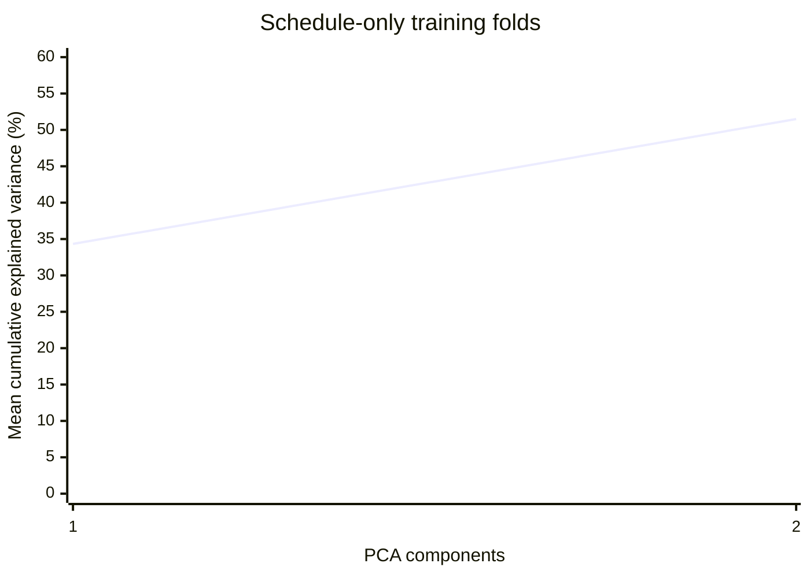

# Phase A P4 classical models

## Verified development run

The schedule-only smoke run used 20,000 flights from P1's `phase-a-data-v1` development Parquet (5,749,041 total flights, SHA-256 `8166d5f05de4ace74dd75d69ee2867686f45237105599a927f9a519382a29e57`). It retained 12 scores per configuration across four forward folds and three seeds (42, 73, 101). The run used one schedule feature matrix with no checkpoint assigned. The reserved holdout starts on November 2, 2025 at 00:00 UTC and stayed reserved throughout the real-data work. [Development release](https://github.com/oki-dokii/Flight-Departure-Delay-Prediction-/releases/tag/phase-a-data-v1) · [Frozen split](../SPLIT_DESIGN.md)

From the repository root, use Python 3.12 and the pinned project requirements. Download only the development Parquet for this run.

```bash
python3.12 -m venv .venv
.venv/bin/python -m pip install -r requirements.txt
mkdir -p data/processed/p4/timing
curl -fL https://github.com/oki-dokii/Flight-Departure-Delay-Prediction-/releases/download/phase-a-data-v1/flights_development.parquet \
  -o data/processed/flights_development.parquet
export OPENBLAS_NUM_THREADS=1 OMP_NUM_THREADS=1 VECLIB_MAXIMUM_THREADS=1 MKL_NUM_THREADS=1
.venv/bin/python -m unittest discover -s tests -v
/usr/bin/time -l .venv/bin/python -m src.run_classical --schedule-only \
  --output data/processed/p4/schedule_smoke 2> data/processed/p4/timing/all.time
for model in majority decision_tree random_forest logistic pca_logistic; do
  /usr/bin/time -l .venv/bin/python -m src.run_classical --schedule-only --model "$model" \
    --output "data/processed/p4/timing/$model" 2> "data/processed/p4/timing/$model.time"
done
```

The sampler sorts flight IDs within each scheduled UTC month from January through October, draws up to 2,000 without replacement with NumPy's seed 42, then sorts the selected IDs for alignment. It selects targets from IDs and scheduled timestamps before reading their labels. It converts `CRSDepTime` to scheduled local minutes of day with P1's `hhmm_minutes` and wraps `2400` to midnight. The other predictors are scheduled elapsed time, distance, carrier, origin, and destination. [Preparation code](../src/prepare.py) · [Runner](../src/run_classical.py)

All four original protocol tests passed before implementation. The completed suite passed all 15 tests, including the synthetic paired run. The fresh-process schedule runs reproduced the full smoke run's 60 fold–seed scores.

| Fold | UTC validation month | Smoke train | Smoke validation | Smoke late rate | Release train | Release validation |
| --- | --- | ---: | ---: | ---: | ---: | ---: |
| 1 | July 2025 | 11,922 | 2,000 | 28.60% | 3,369,902 | 616,012 |
| 2 | August 2025 | 13,935 | 2,000 | 24.75% | 3,986,997 | 596,812 |
| 3 | September 2025 | 15,948 | 2,000 | 16.05% | 4,586,913 | 559,894 |
| 4 | October 2025 | 17,937 | 2,000 | 17.95% | 5,145,343 | 585,051 |

P1 reports PR-AUC as average precision for `LATE=1`. The table shows means and population standard deviations across the 12 fold–seed scores, so the spread includes variation across validation months. The explicit most-frequent factory matched P1's majority scores. Its constant scores give ROC-AUC of 0.5 and average precision equal to the corresponding validation prevalence. [Evaluator](../src/evaluate.py)

| Fixed Phase A configuration | ROC-AUC | PR-AUC (average precision) | Accuracy |
| --- | ---: | ---: | ---: |
| Majority | 0.5000 ± 0.0000 | 0.2184 ± 0.0507 | 0.7816 ± 0.0507 |
| Decision Tree | 0.6689 ± 0.0133 | 0.3308 ± 0.0639 | 0.7792 ± 0.0498 |
| Random Forest | 0.6854 ± 0.0124 | 0.3584 ± 0.0731 | 0.7816 ± 0.0507 |
| Logistic regression | 0.6700 ± 0.0137 | 0.3454 ± 0.0733 | 0.7811 ± 0.0487 |
| PCA + logistic regression | 0.6729 ± 0.0172 | 0.3166 ± 0.0782 | 0.7816 ± 0.0507 |

## Fixed model settings and PCA comparison

| Model | Settings |
| --- | --- |
| Majority | `DummyClassifier(strategy="most_frequent")` |
| Decision Tree | `max_depth=6`, `min_samples_leaf=25`, `ccp_alpha=0` |
| Random Forest | `n_estimators=32`, `max_depth=12`, `min_samples_leaf=10`, `max_features="sqrt"`, `class_weight=None`, `n_jobs=1` |
| Logistic regression | `solver="newton-cg"`, `C=1`, `max_iter=1000`, `class_weight=None` |
| PCA + logistic regression | Identical logistic regression with centered `PCA(n_components=2, svd_solver="arpack", whiten=False)` |

Matching the logistic runs by fold and seed, inserting PCA changed ROC-AUC by +0.00293 ± 0.00614, average precision by −0.02878 ± 0.00971, and accuracy by +0.00050 ± 0.00215. Average precision declined in all four folds. On the training slices one component retained 34.326% of the preprocessed variance on average, and two retained 51.489%. The two-component total ranged from 51.468% to 51.504% across fitted runs. Each training matrix had 273 encoded columns at 2.20% density. `pca_diagnostics.csv` contains the unrounded fold–seed measurements.



The PDF version is generated from the measured diagnostics. The following optional plotting command installs Matplotlib into the ignored output tree and leaves the project environment pinned.

```bash
.venv/bin/python -m pip install --no-cache-dir --constraint requirements.txt \
  --target data/processed/p4/plot_deps matplotlib==3.11.2
MPLCONFIGDIR=data/processed/p4/mpl_config \
  PYTHONPATH=data/processed/p4/plot_deps .venv/bin/python - <<'PY'
from pathlib import Path
import matplotlib
matplotlib.use("Agg")
import matplotlib.pyplot as plt
import pandas as pd

output = Path("data/processed/p4/schedule_smoke")
variance = pd.read_csv(output / "pca_diagnostics.csv")
by_fold = variance.groupby(["fold", "component"])["cumulative_variance_ratio"].mean().unstack(0) * 100
fig, ax = plt.subplots(figsize=(6, 3.5), layout="constrained")
ax.plot(by_fold.index, by_fold, color="#8493a5", alpha=0.4)
ax.plot(by_fold.index, by_fold.mean(axis=1), "o-", color="#155e75", label="Mean across folds")
ax.set(xlabel="Number of PCA components", ylabel="Cumulative explained variance (%)",
       title="Schedule-only training folds", xticks=[1, 2], ylim=(0, 60))
ax.grid(axis="y", alpha=0.25)
ax.legend()
fig.savefig(output / "pca_explained_variance.pdf")
PY
```

## Resource measurements and provisional projections

Measurements used an Apple M3 (8 CPU cores, 8 GiB RAM) on macOS 27.2.1, Python 3.12.5, scikit-learn 1.6.1, NumPy 2.2.6, pandas 2.2.3, PyArrow 20.0.0 and SciPy 1.18.1. The forest used one job and the command limited BLAS and OpenMP to one thread. Each timing row comes from a fresh process and includes selection from the development Parquet. Parquet time measures projected reads, decoding and conversion to pandas. Input time also includes sorting, sampling, alignment, normalization and fold checks. Eval time covers a complete three-seed `evaluate()` call, including P1's extra baseline fits. Peak RSS is the macOS `time -l` maximum resident set size in bytes converted to GiB. It covers the entire process including the source reads.

| Configuration | Sample rows | Parquet (s) | Input (s) | Eval (s) | Wall (s) | Peak RSS (GiB) | Full development eval estimate (min) |
| --- | ---: | ---: | ---: | ---: | ---: | ---: | ---: |
| Majority | 20,000 | 1.61 | 5.74 | 0.068 | 6.96 | 1.54 | 0.32–0.52 |
| Decision Tree | 20,000 | 1.60 | 5.77 | 0.622 | 7.50 | 1.56 | 2.98–4.77 |
| Random Forest | 20,000 | 1.75 | 6.22 | 1.511 | 8.95 | 1.30 | 7.23–11.59 |
| Logistic regression | 20,000 | 1.95 | 6.13 | 0.616 | 8.32 | 1.30 | 2.95–4.73 |
| PCA + logistic regression | 20,000 | 1.58 | 5.74 | 0.572 | 7.69 | 1.44 | 2.74–4.38 |

The combined five-model smoke process took 9.93 seconds wall time and reached 1.51 GiB peak RSS. Input preparation took 5.72 seconds, including 1.66 seconds of projected reads. The five evaluator calls took 3.12 seconds in total.

The forecasts compare two workload assumptions using the verified fold sizes. Linear scaling uses the 287.07× ratio of summed train and validation rows (19,446,924 / 67,742). Row-log-row scaling uses the 460.04× ratio of `Σ(slice_rows × ln(slice_rows))` as a second scenario for sorting and fitting costs. Both multiply the measured evaluator time at three seeds on this hardware. They assume comparable encoded width, density and solver iterations and exclude feature building, input preparation and tuning. They are provisional schedule-only scenarios, and actual costs can fall outside them. Budget both P3 checkpoints from their own timed pilots once available. At the largest released training fold the dense PCA score matrix alone takes about 78.5 MiB at two float64 components or 3.07 GiB at 80, before the encoded input, solver work arrays or copies.

## P3 acceptance and P1/P5 handoff

P3's prototype at `0831fa6` specifies 360 and 60 minutes. Its real-data exporter selects January, which leaves all four P1 validation windows empty. The published Phase A release provides P1's development data and cleaning counts. Acceptance still needs P3's approved paired multi-month feature Parquets with matching real `flight_id`s, feature-spec revision, release identifier, offsets, and agreed predictor roles. The smoke run writes the shared target list to `data/processed/p4/schedule_smoke/sampled_ids.parquet` for a paired handoff over these targets. P3 should build historical features using the full eligible event history before filtering to the target list. P2/P3 approval must establish observation and publication availability, including tail assignments, at each checkpoint. [P3 prototype](https://github.com/oki-dokii/Flight-Departure-Delay-Prediction-/tree/0831fa630a6b3d02969fe17ac8c2aca7095c6c9e) · [Development release](https://github.com/oki-dokii/Flight-Departure-Delay-Prediction-/releases/tag/phase-a-data-v1)

Put the approved manifest in `data/processed/p4/checkpoint_inputs.json`. Use the fields shown below with the full audited predictor list. Both files must contain one physical `flight_id` field and the declared predictors. The optional `sampled_ids` Parquet must contain just `flight_id`. Paths are relative to the repository root. If Parquet schema metadata includes `checkpoint_minutes`, `source_release` or `feature_spec_revision`, the runner compares those values with the manifest.

```json
{
  "development": {
    "path": "data/processed/flights_development.parquet",
    "release": "phase-a-data-v1"
  },
  "feature_spec_revision": "<approved P3 revision>",
  "predictors": [
    {"name": "distance", "role": "numeric"},
    {"name": "carrier", "role": "categorical"},
    {"name": "inbound_missing_no_tail", "role": "indicator"}
  ],
  "checkpoints": [
    {"path": "data/processed/p4/p3_360.parquet", "offset_minutes": 360, "source_release": "phase-a-data-v1"},
    {"path": "data/processed/p4/p3_60.parquet", "offset_minutes": 60, "source_release": "phase-a-data-v1"}
  ],
  "sampled_ids": "data/processed/p4/schedule_smoke/sampled_ids.parquet"
}
```

```bash
.venv/bin/python -m src.run_classical \
  --input-manifest data/processed/p4/checkpoint_inputs.json \
  --output data/processed/p4/paired_smoke
```

Paired acceptance requires all 120 scores and 10 summary rows, including one majority reference per checkpoint, with both classes present in each frozen train and validation slice. Both files are checked and aligned by ID before fitting. P1's actual and scheduled departure timestamps and `LATE` stay in metadata. Offsets must fit the 24-hour fold gap so every scored flight's checkpoint is at or after its validation fold's training cutoff. For fresh-process timing after paired validation, add `--model random_forest --checkpoint-minutes 360` and use a separate output directory. `runs.csv` and `summary.csv` retain full precision. `metadata.json` carries fold sizes, validation prevalence, settings, versions and input provenance. The paired path passed a synthetic contract test with shuffled IDs and both offsets.

P1 can use `classical_factories(schema)[name]` directly with `evaluate(factory, X, development, seeds=SEEDS)`. The runner uses the harness's positional folds, reads its summary by estimator and metric, and retains the explicit majority configuration once. P1 verifies each training label was observable before the fold cutoff. [Evaluator](../src/evaluate.py) · [Frozen splits](../src/splits.py)

P5 can reuse the time windows, seeds, agreed features, keyed alignment and scoring definitions. P4 median-imputes numeric features inside each training fold, preserving an all-missing training column with a zero fallback. The logistic variants also standardize the numeric block. Categorical nulls use a reserved token before sparse one-hot with at most 128 output categories per field. Unknown categories map to the infrequent bucket when one exists and produce an all-zero block otherwise. An audited binary availability indicator preserves distinctions when a missing token shares an infrequent bucket. Indicators stay binary and pass through. Boosting variants can document native category handling on the same keyed cohort and train-only fitting protocol. [Model factories](../src/models_classical.py)

## Phase B validation tuning and analyses

Use the same staged search at both checkpoints on the same development targets. Freeze the candidate budget and order before scoring. Within each model family and checkpoint, shortlist configurations within 0.002 of the best mean validation average precision. Prefer fewer fitted leaves for trees, fewer trees followed by fewer fitted nodes for forests, and fewer components for PCA. Then prefer higher mean ROC-AUC and fixed grid order. Run finalists on the same larger cohort if a smaller cohort was used for screening. Record candidate settings, fold and seed results, model size where relevant, and elapsed time.

| Model | Planned grid and sequence |
| --- | --- |
| Decision Tree | `max_depth ∈ {3, 6, 12, None}`, `min_samples_leaf ∈ {10, 50, 200}`, `ccp_alpha ∈ {0, 1e-6, 1e-5, 1e-4, 1e-3}`. Screen the twelve depth/leaf pairs at alpha zero, then sweep alpha for the two leading pairs. |
| Random Forest | `n_estimators ∈ {64, 128, 256}`, `max_depth ∈ {12, 24, None}`, `min_samples_leaf ∈ {10, 50}`, `max_features ∈ {"sqrt", 0.3}`, `class_weight ∈ {None, "balanced"}`. Start with 64 trees, sqrt features and no class weighting. Screen six depth/leaf pairs, then cross feature and weight options on the top two. Compare 128 and 256 trees on the finalists if the pilot shows capacity. Reuse duplicate runs. |
| PCA + logistic regression | `n_components ∈ {2, 5, 10, 20, 40, 80}`. Use the same integer per candidate and keep only settings supported by every fold's transformed shape and the memory budget. Hold both logistic models at `C=1` with the same solver, class weights, features and preprocessing. |

- **Tree depth and pruning.** Plot mean validation ROC-AUC and average precision with fold–seed spread against depth at fixed leaf size and alpha, and record fitted depth and leaf counts. Compute `cost_complexity_pruning_path` on each preprocessed training slice using matched settings and seeds. If the fixed alpha grid misses the relevant path, choose a bounded set of supplemental shared alphas from the earliest training fold's path before scoring, excluding the root-only endpoint. Plot validation scores and fitted leaf counts against alpha, including zero.
- **Forest class weighting.** Compare `None` and `"balanced"` at matched forest settings, folds and seeds. Derive balanced class weights from each training fold and score on the original validation distribution. Report paired ROC-AUC and average precision changes with runtime and fitted node counts.
- **PCA and matched control.** Fit diagnostic PCA at the largest feasible count on each preprocessed training slice and plot mean cumulative explained variance and fold spread over the common component range for each checkpoint. Mark the count selected on validation average precision and report the maximum retained variance if a reference threshold is out of range. Compare scores and runtime to the no-PCA control at matching checkpoint, fold and seed.

Phase A ran the fixed settings above. The depth and pruning curves, class-weight sweep and higher-component PCA search belong to Phase B and feed the benchmark report. The reserved evaluation supplies final generalization scores after the team selects and freezes the models.
